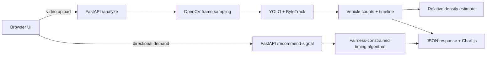

# AI Smart Traffic Management System

**FLOWAI — Making Indian Cities Smarter with AI-Powered Traffic Intelligence**  
Track: Digital India & Smart Technologies

A university Tech Expo prototype that analyzes an uploaded traffic video with YOLO + OpenCV, estimates relative traffic density, visualizes counts, and recommends four-way signal timings using a transparent demand-allocation algorithm.

> **Honest implementation note:** Video detection runs through a real Ultralytics YOLO model when model weights are available. Density is a configurable relative heuristic, not a calibrated traffic-engineering measurement. Signal timings are a simulation, not a trained AI prediction or a controller connected to road infrastructure. The current version returns a source-video preview; annotated-video export is not implemented yet.

## Features

- Responsive dark smart-city dashboard with Chart.js visualizations
- MP4, AVI and MOV upload, preview, drag-and-drop and 100 MB backend limit
- YOLO vehicle classes: bicycle, car, motorcycle, bus and truck
- ByteTrack IDs used to reduce duplicate counts across sampled frames
- Density levels based on average detections per sampled frame
- Four-way signal timing recommendation with minimum/maximum green bounds and clearance time
- Downloadable JSON and CSV analysis report
- FastAPI health endpoint and CORS allowlist
- Temporary uploads removed after processing

## Architecture



## Repository structure

```text
ai-smart-traffic-management/
├── frontend/
│   ├── index.html
│   ├── style.css
│   └── script.js
├── backend/
│   ├── main.py
│   ├── traffic_detector.py
│   ├── density_estimator.py
│   ├── signal_optimizer.py
│   ├── requirements.txt
│   └── .env.example
├── docs/
│   └── architecture.md
├── .gitignore
└── README.md
```

## Requirements

- Python 3.12 recommended (Ultralytics dependencies may vary by operating system and accelerator)
- Git
- A modern browser
- Internet access on first run if YOLO model weights must be downloaded

## Run locally (VS Code)

### 1. Get the code and create a virtual environment

```bash
git clone https://github.com/YOUR-USERNAME/ai-smart-traffic-management.git
cd ai-smart-traffic-management
python -m venv .venv
```

Activate it:

**Windows PowerShell**
```powershell
.\.venv\Scripts\Activate.ps1
```

**Windows CMD**
```bat
.venv\Scripts\activate.bat
```

**macOS / Linux**
```bash
source .venv/bin/activate
```

### 2. Install backend packages

```bash
cd backend
pip install -r requirements.txt
```

Copy `.env.example` to `.env` and adjust values if needed. Environment variables are read by the server process; for local use you can set them in your terminal before starting Uvicorn.

**PowerShell example**
```powershell
$env:YOLO_MODEL="yolov8n.pt"
$env:CORS_ORIGINS="http://127.0.0.1:5500,http://localhost:5500"
uvicorn main:app --reload
```

**macOS / Linux**
```bash
export YOLO_MODEL=yolov8n.pt
export CORS_ORIGINS=http://127.0.0.1:5500,http://localhost:5500
uvicorn main:app --reload
```

The API runs at `http://127.0.0.1:8000`. Open interactive API docs at `http://127.0.0.1:8000/docs`. On first startup, Ultralytics may download `yolov8n.pt`; this requires internet access. Do not commit model weights.

### 3. Open the frontend

From the repository root, use the VS Code **Live Server** extension to open `frontend/index.html` (typically `http://127.0.0.1:5500`). Alternatively, run:

```bash
python -m http.server 5500 --directory frontend
```

Then visit `http://127.0.0.1:5500`.

The frontend defaults to `http://127.0.0.1:8000`. For a deployed backend, set `window.TRAFFIC_API_BASE` before `script.js` in `index.html`, e.g.:

```html
<script>window.TRAFFIC_API_BASE = "https://YOUR-BACKEND.onrender.com";</script>
<script src="script.js"></script>
```

### 4. Test the app

1. Ensure the backend `/health` endpoint says `model_loaded: true`.
2. Upload a short traffic video (preferably 10–30 seconds, with vehicles visible).
3. Click **Start traffic analysis** and wait for the response.
4. Review the count, density estimate and charts; download JSON/CSV.
5. Adjust directional demand in **Signal Lab** and calculate recommendations.

Use video footage you have permission to process. Avoid uploading identifiable or sensitive footage to public demo hosting.

## API endpoints

### `GET /health`
Returns service status, configured model and whether weights loaded.

### `POST /analyze`
Multipart form field: `file`. Accepts `.mp4`, `.avi`, `.mov`; validates size; samples frames; runs YOLO tracking; returns structured JSON including `vehicle_counts`, `timeline`, density estimate and processing duration. Upload files are removed after the request.

### `POST /recommend-signal`
JSON example:

```json
{
  "demand": {"north": 18, "south": 12, "east": 25, "west": 8},
  "cycle_seconds": 120,
  "min_green_seconds": 10,
  "max_green_seconds": 60,
  "clearance_seconds": 4
}
```

### `GET /results/{analysis_id}`
Returns `404` in this version because persistent result storage is intentionally not enabled. Results are returned immediately by `/analyze` and can be downloaded in the browser.

## Model and algorithm notes

- Default model is `yolov8n.pt` (small COCO-pretrained YOLOv8 model). Set `YOLO_MODEL` to a local model path or supported Ultralytics model name.
- Vehicle classes use COCO IDs: bicycle 1, car 2, motorcycle 3, bus 5, truck 7.
- ByteTrack track IDs are counted once per analysis. Sampling every 0.5 seconds improves speed but can miss short-lived tracks or vehicles occluded between samples.
- Density uses average detections per sampled frame: default LOW below 7, MEDIUM from 7 to below 18, HIGH at 18 or more. The displayed score is normalized to a 0–100 range using the high threshold. These are demo defaults; calibrate with labeled footage and a defined road region for meaningful comparisons.
- Signal algorithm gives each approach a minimum green time, allocates remaining green time proportionally to demand, caps at maximum green, and reserves clearance time per phase. It does not model pedestrian phases, turning conflicts, road geometry, queue discharge, emergency vehicles or legal signal standards.

## Deployment

### GitHub repository

1. Create an empty repository named `ai-smart-traffic-management` on GitHub.
2. From the project root:

```bash
git init
git add .
git commit -m "Build AI smart traffic management prototype"
git branch -M main
git remote add origin https://github.com/YOUR-USERNAME/ai-smart-traffic-management.git
git push -u origin main
```

### GitHub Pages (frontend only)

1. Open repository **Settings → Pages**.
2. Select **Deploy from a branch**, choose `main` and `/frontend` if supported by your Pages setup. If Pages only offers the root folder, move/copy the frontend to root or use a GitHub Actions Pages workflow.
3. Configure `window.TRAFFIC_API_BASE` to your deployed backend URL.
4. Add the GitHub Pages origin (e.g. `https://YOUR-USERNAME.github.io`) to backend `CORS_ORIGINS`.

**GitHub Pages cannot run Python, FastAPI, OpenCV or YOLO inference.** The backend must be deployed separately.

### Backend on Render or another Python host

- Create a new Web Service linked to the GitHub repository.
- Set root directory to `backend`.
- Build command: `pip install -r requirements.txt`
- Start command: `uvicorn main:app --host 0.0.0.0 --port $PORT`
- Set environment variables `YOLO_MODEL=yolov8n.pt`, `MAX_UPLOAD_MB=100`, `FRAME_INTERVAL_SECONDS=0.5`, and `CORS_ORIGINS` to your exact frontend origin(s).
- Confirm the host supports the model's memory, CPU time and temporary disk requirements. Free-tier sleep/timeout limits may not suit video inference. For larger models, configure persistent model caching or use a paid service.
- Verify `https://YOUR-BACKEND/health` and then test a short video.

## Limitations and future work

- No persistent result database, authenticated users, annotated video encoding or real traffic-signal hardware integration.
- Detection counts depend on camera view, lighting, occlusion and frame sampling.
- A single scene-level count is not a lane-calibrated density measurement.
- Evaluate on representative annotated clips (precision/recall, counting MAE, density agreement and processing latency) before claiming accuracy or real-world impact.
- Future: polygonal road-region occupancy, line-crossing counts, annotated video output, persistent analysis history, camera calibration, emergency vehicle priority, pedestrian safety constraints and field evaluation.

## Screenshots

Add your own screenshots after running the project:

```text
docs/screenshots/dashboard.png
docs/screenshots/video-analysis.png
docs/screenshots/signal-lab.png
```

## Team credits

Edit the footer in `frontend/index.html` and this section with your team members, university and GitHub repository URL.
